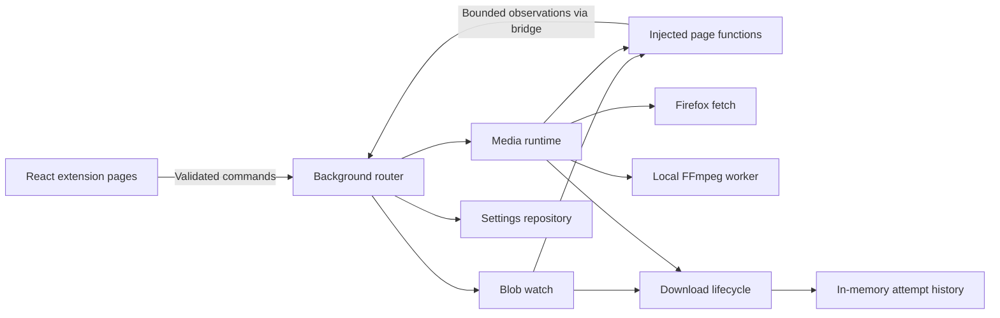

# Architecture

The extension uses Manifest V2 with one persistent background bundle. React,
TypeScript, Tailwind, and the single-thread FFmpeg core are compiled or copied
locally. There are no runtime CDN dependencies. The persistent background owns
shared sessions, conversion work, history, and download object URLs even when a
popup closes.

## Execution boundaries



The UI communicates through the typed `ui/api.ts` helper. The background validates
unknown messages and browser-supplied sender identity before dispatch. Extension
pages can issue user commands; page bridges can report only authorized blob and
element observations. A value supplied by a page is never sufficient to authorize
a command.

## Runtime modules

| Module                             | Responsibility                                                        |
| ---------------------------------- | --------------------------------------------------------------------- |
| `src/background.ts`                | Startup listeners, sender authorization, validated command routing    |
| `src/auto-watch.ts`                | Per-tab capture sessions, frame authorization, bounded capture queues |
| `src/media-runtime.ts`             | Media command orchestration and public snapshots                      |
| `src/runtime/history.ts`           | Bounded attempt metadata and native download associations             |
| `src/runtime/downloads.ts`         | Blob decoding, object URLs, native download events and reconciliation |
| `src/runtime/images.ts`            | Image scanning and per-tab bulk download queues                       |
| `src/runtime/media/catalog.ts`     | Detected resources and element observations                           |
| `src/runtime/media/monitoring.ts`  | Explicit network and DOM monitoring sessions                          |
| `src/runtime/media/observation.ts` | Validation of page observations                                       |
| `src/runtime/media/read.ts`        | Permission-checked Firefox reads and input budgets                    |
| `src/runtime/media/conversion.ts`  | One conversion job, cancellation and progress                         |
| `src/runtime/settings/`            | Settings commands and serialized storage updates                      |
| `src/hls/`                         | Playlist parsing/collection and local remux adapter                   |
| `src/shared/`                      | Contracts, validators, limits, filenames and settings schema          |

Keep mutable stores private. Expose operations and snapshots instead of exporting
maps or wiring modules through a shared service container. Background features
share state through explicit imports in the single bundle.

## Injected code

`src/injected/` functions run in a page world after Firefox serializes their
bodies. All runtime dependencies must be declared inside those functions.
Imported runtime helpers, outer variables, compiler wrappers and name helpers
will not be present in the receiving world. Type-only imports disappear safely.

The background bundle stays unminified with `keepNames` disabled. Hook tests
execute compiled serialized function source without its original module closure.
Preserve this test when reorganizing injection code.

## UI composition

`ui/main.tsx` determines the entry mode and mounts the application. `ui/app/`
owns providers, source selection, theme/navigation, task feedback and dashboard
actions. `ui/features/` contains blob, image, media and history controllers and views.
Pure transitions live in `ui/state/`; polling and reply ordering live in
`ui/services/`. Settings have their own provider above the source workspace.

State contexts and action contexts are separate. Views call feature actions;
providers perform commands. Shared inputs in `ui/components.tsx` own transient
interaction details such as open menus, highlighted options and focus restoration.
See [state management](state-management.md) before changing a provider lifetime.

The native toolbar popup needs an intrinsic body width of 400px. Do not constrain
it with `max-width: 100vw`: Firefox determines the popup viewport from its content,
so that constraint can feed the initial viewport width back into sizing. In Tor
this collapsed the popup content to 10px. The preview renderer applies its own
responsive width override for embedded/narrow tests; it does not ship in the
runtime. Verify native panel sizing with `scripts/smoke-test-popup.mjs` as well as
the preview-based UI checks.

## Build and entry pages

`scripts/build.mjs` invokes implementations in `scripts/build/`. Strict type
checking precedes runtime generation. The build bundles background and UI code,
generates Tailwind CSS, copies runtime HTML/icons/notices, and packages local
FFmpeg assets. Its vendor patch asserts the pinned upstream dynamic-import
pattern before replacing it with a literal local import.

The current entry pages are `popup.html`, `history.html` and the `index.html`
options/dashboard page. The dashboard has a distinct settings and linked-source
purpose. Do not add interchangeable entry pages.

`extension/`, `.build/`, `.dev-session/`, `artifacts/` and `dist/` are generated.
Development test exports and preview APIs compile under `.build/`, outside the
shipping runtime. `examples/` and `scripts/testing/` supply fixtures, not shipping
permissions or page bridges. Never edit generated bundles to fix source behavior.

## Repository layout

```text
src/
  background.ts        Startup, sender authorization, command routing
  auto-watch.ts        Blob-watch lifecycle and capture coordination
  media-runtime.ts     Media commands and state composition
  injected/            Self-contained page hooks, bridges, reads, DOM observer
  runtime/             History, downloads, media catalog/monitoring/conversion
  shared/              Contracts, command validation, filenames, limits
  hls/                 Playlist parser/collector and FFmpeg adapter
  ui/                  React TSX, typed API helper, Tailwind styles
  manifest.json        Editable manifest template
  popup.html           React popup entry template
  history.html         React history entry template
  icons/               Custom SVG assets
extension/             Generated, directly loadable runtime (ignored by Git)
scripts/               Small build, install/remove, preview, live-check entry points
  build/               Compiler, runtime assets, vendor assets and patching
  browser/             Copied-profile guard, debugger transport, permission task
  session/             Options, ownership store, lifecycle and start/stop workflows
  preview/             Asset allowlist, document rendering, HTTP server
  lib/                 Shared project paths and CLI helpers
  testing/             Test-only runtime fixture builder
tests/                 Node unit/regression tests
examples/              Manual blob page and preview mocks (not packaged)
dist/                  Timestamped unsigned ZIP/XPI packages
```
